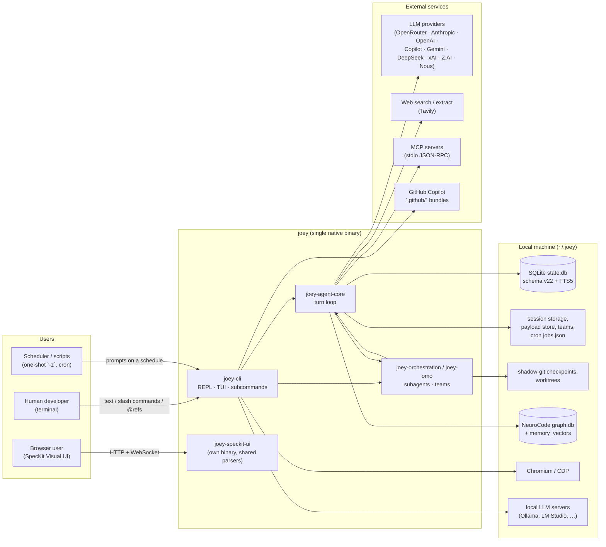
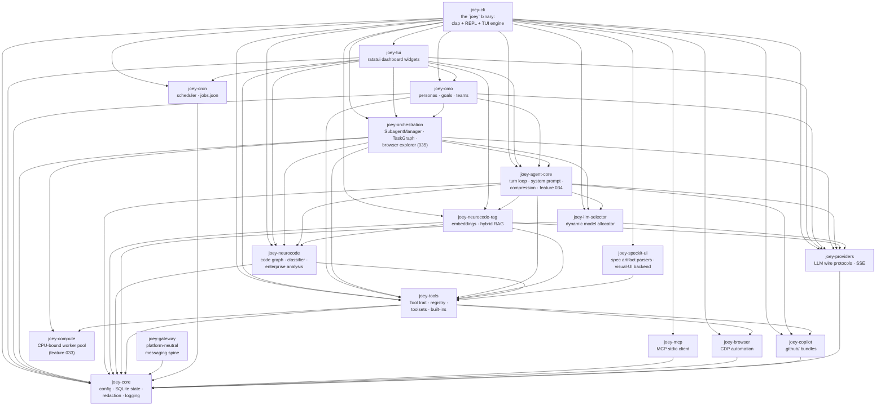
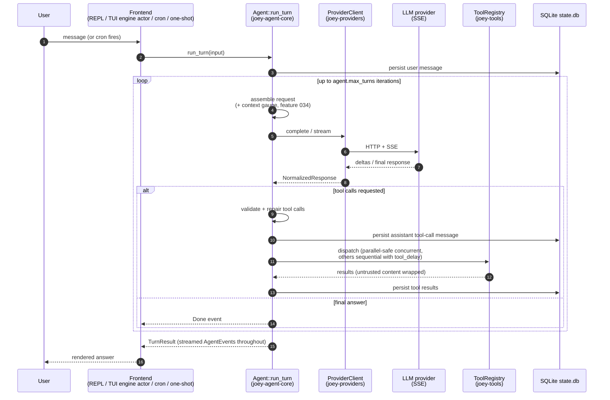
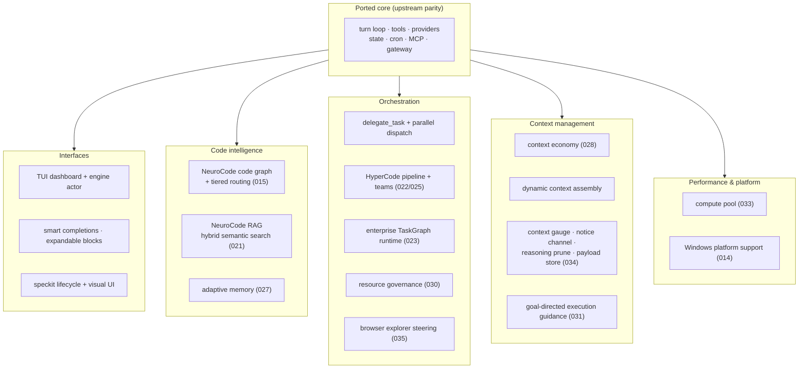

# Architecture Overview

Joey Agent is a Cargo workspace of **18 crates**. The first eight are a
direct, well-scoped port of the upstream Python project (Hermes Agent), one
module per crate. The remaining ten — `joey-tui`, `joey-llm-selector`,
`joey-orchestration`, `joey-omo`, `joey-speckit-ui`, `joey-browser`,
`joey-neurocode`, `joey-neurocode-rag`, `joey-copilot`, and `joey-compute` —
are joey-native additions layered on top of the ported core; they have no
upstream Python equivalent. The dependency graph is a strict DAG — lower
crates never depend on higher ones.

All diagrams below are [Mermaid](https://mermaid.js.org) flowcharts; GitHub
renders them natively.

## System context

Joey at the center; everything it talks to around it:

## Workspace crate DAG

Edges point from a crate to its dependencies (compiled bottom-up; the
workspace is a strict DAG — no cycles, lower crates never depend on higher
ones):

Layer summary (top → bottom):

| Layer | Crates | Role |
|---|---|---|
| **Frontends** | `joey-cli`, `joey-tui` | everything the user touches: argument tree, REPL, TUI engine-actor, slash commands |
| **Orchestration** | `joey-orchestration`, `joey-omo` | subagent delegation, HyperCode pipeline, task graphs, teams, personas, browser explorer |
| **Agent core** | `joey-agent-core`, `joey-llm-selector` | the turn loop, prompt assembly, context management, dynamic model allocation |
| **Intelligence** | `joey-neurocode`, `joey-neurocode-rag` | code-graph analysis, tiered routing, semantic RAG |
| **Tools & integrations** | `joey-tools`, `joey-browser`, `joey-mcp`, `joey-copilot`, `joey-speckit-ui`, `joey-cron`, `joey-gateway` | the tool registry and every capability exposed to the model |
| **Substrate** | `joey-providers`, `joey-compute`, `joey-core` | provider wire protocols, CPU-bound execution, config/state/logging |

## Crate responsibilities

### Ported from Hermes Agent

| Crate | Ports (upstream Python) | Responsibility |
|---|---|---|
| `joey-core` | `hermes_constants.py`, `hermes_state.py`, `config.py`, logging, redaction | Path/profile resolution (`~/.joey`), layered YAML+env config, the SQLite session store, secret redaction, reasoning-effort parsing, ANSI theme, time helpers |
| `joey-providers` | `providers/`, `agent/transports/` | Provider profile registry, OpenAI Chat Completions / OpenAI Responses / Anthropic Messages wire adapters, SSE streaming, error classification and backoff |
| `joey-tools` | `tools/`, `toolsets.py` | The `Tool` trait and dispatch registry, toolset resolution, JSON-schema sanitizer, fuzzy patch matcher, payload store (feature 034 pass-by-reference), built-in tools (files, terminal, process, memory, todo, skills, web, session search, clarify, LSP) |
| `joey-agent-core` | `run_agent.py`, `agent/conversation_loop.py`, `agent/prompt_builder.py`, `agent/context_compressor.py` | The turn loop itself: message assembly, system prompt construction, tool-call validation/dispatch, retries/fallback, context compression, threat scanning, goal-directed guidance (031), context gauge / notice channel / reasoning pruning (034) |
| `joey-cron` | `cron/` | Self-contained scheduler: job store (`~/.joey/cron/jobs.json`), croniter-compatible expression matcher, 60s ticker, job runner |
| `joey-mcp` | `tools/mcp_tool.py` (client half) | Model Context Protocol stdio JSON-RPC client: handshake, tool discovery/naming, pagination, timeouts, safe-env subprocess spawning |
| `joey-gateway` | `gateway/` (core) | Platform-neutral session-key builder, `MessageEvent`/`SendResult` types, send-error classification, the `PlatformAdapter` trait (concrete adapters like Telegram/Discord are added behind this trait) |
| `joey-cli` | `hermes_cli/`, `cli.py` | The `joey` binary: clap argument tree, profile resolution, the TUI dashboard as the DEFAULT interactive interface (`--cli` for the classic reedline line-REPL; `--tui` to force the dashboard against `JOEY_TUI=0`; non-terminal stdio auto-falls back to the line REPL), one-shot mode, slash commands, smart completions (shared engine in `joey-tools::completion`), the TUI engine-actor runtime (`engine.rs` — GUI/compute decoupling with kill-and-restart), all subcommands (`model`, `config`, `doctor`, `cron`, `mcp`, `skills`, `tools`, `auth`, `discover`, `llm-selector`) |

### Joey-native additions (no upstream equivalent)

| Crate | Responsibility |
|---|---|
| `joey-tui` | The `--tui` animated dashboard: `Tui` runtime (generic over the ratatui backend for testability), `Theme`/gradient rendering, an `App`/`AppState` model, widgets (agent-roster panel, NeuroCode live context feed, completion/slash popups), and a UTF-8-safe input editor with shared-history recall. Rendering/event-pump lifecycle is driven by `joey-cli`'s engine-actor loop. |
| `joey-llm-selector` | Dynamic per-module model allocation used when `model.default = auto`: a `CandidateModelPool`, a persisted `AllocationMap` (`~/.joey/…/allocations.json`), a cold-start `ColdStartScorer`, a diagnoser/learning loop, and the `ModelAllocator` trait consumed by `joey-orchestration` and the parent `Agent` so each call-site can ask "which model for module X". Exposed via the `/llm-selector` slash command and `joey llm-selector` top-level command. |
| `joey-browser` | CDP (Chrome DevTools Protocol) browser automation (feature 016): attach-to-running or managed-launch Chromium sessions, dedicated agent tab, shadow/frame-piercing DOM snapshots, cascading-target resilient actions, MutationObserver settle detection, overlay policy, Set-of-Mark visual fallback, bounded feed deltas, and feature-035 navigate-skipping (`should_skip_navigate`) to keep a steered explorer's page warm. Consumed by `joey-tools`' 16 `browser_*` tools; see [browser.md](browser.md). |
| `joey-compute` | The CPU-bound work execution substrate (feature 033): dedicated OS worker threads (never tokio workers), earliest-deadline-first scheduling with bounded starvation, semaphore admission/backpressure, panic isolation, chunked cancellation, watchdog, and metrics. Consumed by `joey-tools` (terminal output post-processing) and weighted by `joey-orchestration`. See [compute-pool.md](compute-pool.md). |
| `joey-orchestration` | The subagent/multi-agent delegation engine: `SubagentManager`, the `delegate_task` and `call_omo_agent` tools, per-subagent isolated execution contexts, shared concurrency limits, `register_orchestration*` helpers, the typed TaskGraph runtime and joiner (spec 023), resource governance (feature 030), and the orchestrator-steered **browser explorer** registry (feature 035). Depends on `joey-llm-selector::ModelAllocator` and a `CategoryResolver` trait (implemented by `joey-cli` to bridge into `joey-omo` without a circular dependency). |
| `joey-omo` | "Oh My OpenAgent": an 11-agent persona registry (`AgentRegistry`, `OmoAgent`) with per-agent model-family fallback chains (`AvailableModelSet`, `resolve_model`), category/subagent delegation routing (`resolve_category`, `route_delegation`), plan parsing and Atlas-style plan execution (`prepare_plan_execution`, `start_work`), intent gating for ultrawork/hyperplan/team triggers (`detect_keyword`, `check_ultrawork_activation`), per-session `GoalState`, an accumulated-wisdom notepad, and team-mode primitives (`TeamSpec`, `TeamMailbox`, `TeamTaskList`, optional tmux visualizer). Wired into both the REPL and TUI paths of `joey-cli` (agent roster, `/agents`, `/start-work`, `/goal`, intent gating). |
| `joey-speckit-ui` | The spec-kit artifact engine: typed parsers for `specs/<feature>/{spec,plan,tasks}.md` (also reused **inside** `joey-cli`'s speckit lifecycle commands), conflict-checked (hash-based optimistic-locking) writes, a workflow runner, and a standalone HTTP + WebSocket backend (own binary, `cargo run -p joey-speckit-ui`) serving the `web/speckit-ui` frontend. |
| `joey-neurocode` | The NeuroCode enterprise code-analysis engine (feature 015): a per-project code-graph SQLite store (schema v3), multi-language ingest (tree-sitter; Java/Pega-aware), a tiered complexity classifier that feeds model routing, context assembly, adaptive memory (feature 027), the enterprise analysis plane (policy/risk/verification-plan, spec 023), and the `neurocode_*` model-facing tools. See the `neurocode.*` config block and [features/joey-neurocode.md](features/joey-neurocode.md). |
| `joey-neurocode-rag` | Local-first semantic RAG over the NeuroCode code graph: embedding backends (5, incl. GitHub Copilot and local ONNX `nomic-embed-text-v1.5`), consent-gated indexing, hybrid BM25+vector RRF search, `memory_vectors` store (schema v4). See [features/joey-neurocode-rag.md](features/joey-neurocode-rag.md). |
| `joey-copilot` | GitHub Copilot `.github/` integration: discovers/validates Copilot extension bundles (instructions, prompts, skills, MCP), generates the plugin manifest, backs the `joey copilot` command. See [copilot.md](copilot.md). |

## End-to-end data flow (one turn)

Narrative form:

1. **Entry point** (`joey-cli`): the user types a message in the REPL or
   the `--tui` dashboard, or supplies `-z "<prompt>"` for one-shot mode, or
   a cron job fires a scheduled prompt.
2. **Agent construction** (`joey-agent-core::Agent::new`): builds a
   `ProviderClient` from the resolved provider profile, snapshots the
   valid/checked tool names, assembles the session-stable system prompt
   (see [agent-core-reference.md](agent-core-reference.md)), and wires up the context
   compressor. `joey-cli` additionally registers the `delegate_task` tool
   (`joey-orchestration`) — bridged to `joey-omo`'s agent registry via a
   `CategoryResolver` — and, when `model.default = auto`, a
   `joey-llm-selector::ModelAllocator`. In the TUI, the constructed Agent
   is then MOVED into a dedicated engine task (`joey-cli/src/engine.rs`);
   the UI drives it purely via channels (see
   [tui.md](tui.md#guicompute-decoupling-engine-actor-model)).
3. **Turn execution** (`Agent::run_turn` in `agent.rs`): the user message
   is appended to history and persisted; the loop then:
   - Assembles the full message list (system prompt + history), appending
     the live context-gauge tail line when `context_gauge.enabled` (034).
   - Calls the provider (`ProviderClient::complete`/`stream`), applying
     jittered backoff across `api_max_retries` attempts and walking the
     `fallback_providers` chain on hard failures.
   - If the assistant requested tool calls, validates/repairs them,
     dispatches read-only ("parallel-safe") tools concurrently and
     everything else sequentially with `tool_delay` spacing between calls,
     wraps untrusted tool output, and loops. A `delegate_task` call spins
     up a `joey-orchestration::SubagentManager` execution with its own
     isolated context and (optionally) an allocator-selected model.
   - Otherwise, the turn is done.
   - On context overflow (413 / provider length errors) or when usage
     crosses the compression threshold, the context compressor prunes/
     summarizes history and the request is retried.
   - On iteration-budget exhaustion, tools are stripped and the model is
     asked for a final summary.
4. **Events**: throughout, `AgentEvent`s stream out over an mpsc channel
   to whatever is driving the agent (line-REPL renderer, `joey-tui`
   dashboard, or gateway adapter), carrying content/reasoning deltas, tool
   start/end, retries, compression notices, and the final `Done`/`Failed`.
5. **Persistence**: every durable message (user, assistant, tool result)
   is written to `~/.joey/state.db` as it's produced; ephemeral recovery
   scaffolding (e.g. synthetic repair messages) is tracked separately and
   never persisted.

## Design principles visible in the code

- **Byte-for-byte prompt fidelity.** Guidance strings shown to the model
  (`guidance.rs`) are ported verbatim from upstream, because subtle
  wording changes measurably affect model behavior. Comments explicitly
  flag anywhere behavior *had* to diverge (branding, missing OAuth
  impersonation, etc). Joey-only guidance additions (context economy,
  adaptive coding, goal-directed execution) are pinned by contract tests
  instead.
- **Explicit registration over reflection.** Where upstream Python
  discovers tools via import side effects, the Rust port registers every
  built-in tool explicitly in `joey_tools::builtins::register_all`,
  trading a little verbosity for compile-time guarantees.
- **The system prompt is built once per session** and never re-rendered,
  specifically to keep provider prompt-prefix caches warm — this is a
  hard constraint baked into `Agent::new`/`build_system_prompt`. Additive
  context features (034 gauge, dynamic context assembly) are strictly
  tail-only for the same reason.
- **Defense in depth on untrusted content.** Context files, tool results
  from `web_search`/`web_extract`/`browser_*`/`mcp_*`, and MCP server
  configs each pass through their own sanitization/threat-scan layer
  before ever reaching the model or the shell.
- **Hermes-compatible on-disk formats.** The SQLite schema
  (`SCHEMA_VERSION = 22`), cron `jobs.json` envelope, and skill format are
  intentionally identical to upstream so a `~/.hermes` home can be renamed
  to `~/.joey` and just work.
- **CPU work never blocks the async runtime.** Heavy post-processing goes
  through the `joey-compute` pool (dedicated OS threads, bounded
  admission) so bursts of terminal output can't starve the turn loop.

## Feature layers at a glance

The big joey-native capability layers, newest last (each links to its
reference page):

## Enterprise Orchestration Runtime (spec 023)

A typed, evidence-producing execution plane for hypercode runs, built to
`specs/023-enterprise-orchestration-runtime/` (net-new Joey capability; no
upstream Hermes counterpart). It spans two crates plus CLI wiring and is
gated by two independent feature flags, **both default OFF until the final
flip**: `hypercode.execution_graph.enabled` (the typed TaskGraph runtime)
and `neurocode.enterprise_context.enabled` (the enterprise analysis plane),
with knobs `hypercode.execution_graph.max_concurrent_workers` (16) and
`max_repair_attempts` (3). Flag-off means byte-identical legacy behavior
(SC-001); the flag flip itself is tracked as pending task T033, gated on
T032's parity evidence.

### Analysis plane (`joey-neurocode`, additive — `NeuroCodeEngine` untouched)

- `policy/{sources,resolver}` — instruction-file parsing (FR-003) and
  hierarchical policy combine (FR-002).
- `risk.rs` — task risk scoring (FR-022).
- `verification_plan.rs` — verification-plan derivation (FR-001).
- Classifier graph signals: `SignalKind::GraphHub` activation (FR-004) via
  a shared `Arc<Mutex<DependencyGraph>>`.
- `analysis.rs` — `EnterpriseTaskAnalyzer` trait / `AnalysisEngine`
  (FR-001/FR-005).
- `memory/outcomes.rs` — outcome memory backed by the `outcome_memory`
  SQLite table (FR-025/FR-026); the graph schema stays at v3.

### Execution runtime (`joey-orchestration`)

- `task_graph.rs` — `TaskNode`/`TaskGraph`, six validation invariants
  (FR-009), strict planner JSON `joey-taskgraph/1` (FR-008), legacy-plan
  conversion (FR-007).
- `evidence.rs` — run state under
  `~/.joey/hypercode/projects/<hash>/runs/<run-id>/`, append-only
  `decisions.jsonl` with a 13-cause vocabulary (FR-012/FR-014), resume
  baseline check (FR-030).
- `scheduler.rs` — deterministic wave scheduling, `ConflictAnalyzer`
  partitioning, semaphore concurrency cap (FR-011/FR-029).
- `workspace.rs` — git-worktree isolation with full-copy fallback
  (FR-015).
- `joiner.rs` — `ChangeBundle`, `git apply --3way` with pre-apply conflict
  surfacing (FR-017); no commits are made (FR-018).
- `evaluator.rs` — the `VerificationGate` trait, awaited gates (FR-019),
  repair ledger + exhaustion ladder (FR-021), Degraded outcome (FR-031).

### CLI wiring (`joey-cli`)

- `hypercode.rs` — the execution-graph path (conversion → scheduler →
  isolation → joiner → gates) early-returns behind the flag.
- `hypercode_gate.rs` — `VerifyLoop`→`VerificationGate` adapter with a
  `DefectBundle` repair queue.
- Graph-derived routing (FR-023): `route_mode_from_graph`; the legacy
  `route_mode` is preserved.

### Crate-boundary rule

`joey-orchestration` does **not** import `joey-neurocode` types for the
gate/graph; the CLI adapts between them (`AnalysisTask` stand-in,
`VerificationPlanView` mirror) — the workspace DAG is preserved.

## See also

- **[system-diagrams.md](system-diagrams.md)** — the detailed per-subsystem
  Mermaid diagram collection (turn loop internals, tool dispatch, provider
  stack, context pipeline, orchestration, browser explorer, NeuroCode,
  compute pool, security layers, cron, SpecKit UI).
- [features.md](features.md) — feature-first tour of everything the agent
  does today.
- [agent-turn-loop.md](agent-turn-loop.md) / [agent-core-reference.md](agent-core-reference.md)
  — the turn loop in depth.
