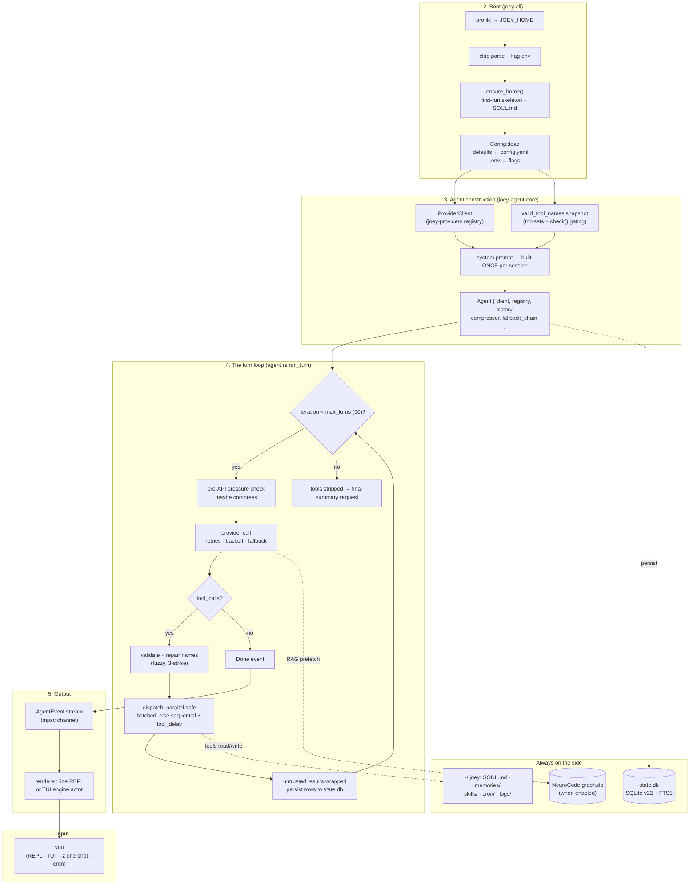

# How Joey Works — End-to-End Walkthrough

This page writes through the system: one request, from the moment you type it,
past every layer, until the answer is on your screen and the session is saved.
It is the connective tissue between the reference pages — every section links
out to the page that owns the subsystem in depth. If you read only one doc,
read this one first; if you need the internals, follow the links.

Conventions: file/line anchors (e.g. `agent.rs:3232`) are approximate
signposts, as in the rest of `docs/`; "upstream" means the Hermes Agent Python
project this is a port of.

## The tour in one diagram

Everything below is that diagram, in order.

---

## 1. Input: how a request arrives

Joey has four entry surfaces, all of which converge on the same agent core:

- **Interactive** — `joey` starts the TUI dashboard by default
  (`use_tui` in `joey-cli/src/main.rs:541`; `--cli` forces the classic
  line REPL, `JOEY_TUI=0` too; non-terminal stdio auto-falls back to the
  line REPL so pipes keep working).
- **One-shot** — `joey -z "prompt"`: prints only the final answer, exits.
  This path *bypasses the interactive stack entirely* and is the surface
  scripts and cron jobs use (`main.rs:586` → `oneshot::run_oneshot`).
- **Scheduled** — `joey cron` jobs fire prompts through the same one-shot
  machinery on a 60s ticker (see §11, [cron.md](cron.md)).
- **Headless gateway** — the `joey-gateway` spine (`MessageEvent` →
  `run_turn` → `SendResult`) for messaging platforms
  ([gateway.md](gateway.md)).

Full CLI surface: [cli.md](cli.md) and
[features/joey-cli.md](features/joey-cli.md).

## 2. Boot: profile, flags, home, config

`main()` (`main.rs:492`) does four things before anything else:

1. **Profile pre-parse** — `-p/--profile <name>` is stripped from argv *before*
   clap runs and re-points `JOEY_HOME` to `~/.joey/profiles/<name>`
   (`apply_profile_override`, `main.rs:497`). Profiles are the unit of
   isolation: separate home, config, state DB, skills, auth.
2. **Clap parse** — the full argument tree (`main.rs:505`); usage errors exit 2.
3. **Flag-to-env wiring** — `--yolo` → `JOEY_YOLO_MODE=1`,
   `--safe-mode` → `JOEY_SAFE_MODE=1` + `JOEY_IGNORE_USER_CONFIG=1`
   (`wire_flag_env`, `main.rs:562`). These are read later by `joey-tools`
   (dangerous-command approvals) and `joey-mcp` (safe-mode gate) — env vars
   are the wire between CLI flags and lower crates, keeping the dependency
   DAG clean.
4. **`ensure_home()`** — creates `~/.joey` if absent, seeds the first-run
   skeleton (`SOUL.md`, `memories/`, `skills/`, …). Every later layer assumes
   the home exists.

Then `Config::load` resolves the layered config:
`DEFAULT_CONFIG` ← `config.yaml` ← `.env` (which *overrides* shell vars, like
upstream) ← CLI flags, with `${VAR}` expansion and dotted-path addressing.
Secret-looking keys (`*_KEY`, `*_TOKEN`, `*_SECRET`, `*_PASSWORD`) are routed
to `.env` automatically. Corrupt config keeps last-known-good + backup.
→ [state-and-config.md](state-and-config.md)

The state layout under `~/.joey` (config, `.env`, `SOUL.md`, `state.db`,
`memories/`, `skills/`, `cron/jobs.json`, `auth.json`, `logs/`,
`neurocode/`) is documented in
[state-and-config.md](state-and-config.md#3-joey-directory-layout).

## 3. Session + agent construction

For interactive/one-shot runs, `joey-cli` decides the session first:

- **new** — fresh `session_id` (or none for anonymous one-shots),
- **`-r <id|title>`** — resume by id or fuzzy title match against
  `state.db`,
- **`-c`** — continue the most recent session.

Resumed sessions load their persisted history, repair any dangling
tool-call tail left by a crash, and re-render the session tail of the system
prompt. → [state-and-config.md](state-and-config.md#4-session-store-stateres)

Then `Agent::new` (`agent.rs:658`) assembles the engine:

- **`build_client`** — resolves the provider profile from
  `joey-providers`' registry (openrouter / openai-api / anthropic / nous /
  deepseek / zai / gemini / xai / copilot / custom + aliases), walks the
  per-provider env-var chains for the API key and base URL (with
  `GLM_BASE_URL` and the four-endpoint Z.AI detection when relevant), and
  builds a `ProviderClient`. → [providers.md](providers.md)
- **`valid_tool_names`** — a *snapshot* of every tool whose `check()` passes
  right now (config gates, platform gates, e.g. LSP tools only when a server
  is configured). The system prompt and later tool-call validation use this
  same snapshot, so what the model is told and what it may call never diverge.
  → [tools.md](tools.md#toolregistry-behavior)
- **`build_system_prompt`** — built **once** and cached for the session. This
  is a hard design constraint: providers cache prompt prefixes, so a stable
  system prompt keeps those caches warm. It is only ever patched in two narrow
  cases (splicing a `Session ID:` line, or rewriting the Model/Provider
  identity lines on `switch_model`/fallback). → §4.
- **`ContextCompressor`** — wired with the configured threshold (0.50),
  protection windows (first 3 / last 20 messages), target ratio, and an aux
  summarization backend (`agent.rs:697`). → §8.
- Optional wiring the CLI adds: a `delegate_task` tool bridged into
  `joey-orchestration` (with `joey-omo`'s agent registry behind a
  `CategoryResolver` trait to avoid a cycle), a
  `joey-llm-selector::ModelAllocator` when `model.default = auto`, NeuroCode
  engine + RAG wiring when `neurocode.enabled = true`, and hooks.

`set_session_store` (`agent.rs:936`) binds the SQLite handle; from that point
every durable message is written as it's produced (§10).

## 4. The system prompt (what the model knows before turn one)

Assembled in tiers by `build_system_prompt`
(`joey-agent-core/src/prompt.rs`; full spec in
[agent-core-reference.md](agent-core-reference.md#2-system-prompt-assembly-promptrs-guidanceres)):

1. **Identity** — `SOUL.md` verbatim (the user-editable "who am I" file).
2. **Guidance** — upstream-verbatim operating rules: task completion,
   parallel tool use, memory usage, skill usage, plus the joey-only
   additive blocks (context economy, adaptive coding, goal-directed
   execution) that are pinned by contract tests.
3. **Environment hints** — platform, cwd, date/timezone, shell, untagged.
4. **Project context files** — `.joey.md`/`JOEY.md` → `AGENTS.md` →
   `CLAUDE.md` → `.cursorrules`, each *threat-scanned* and truncated
   (70/20 head/tail) before inclusion.
5. **Skills** — `## Skills (mandatory)` section listing `<available_skills>`
   by category; loading a skill's body is the model's job via `skill_view`.
   → [features/skills.md](features/skills.md)
6. **Memory blocks** — `MEMORY.md` / `USER.md` in `═`-boxed sections with
   usage gauges, so the model sees how full its long-term memory is.
7. **Session tail** — `Conversation started`, `Session ID`, `Model`,
   `Provider`.

Additive per-turn context (the 034 context gauge tail line, dynamic
context-assembly blocks) is strictly *tail-only*, appended after this stable
prefix, to protect the prompt cache. →
[context-assembly.md](context-assembly.md)

## 5. The turn loop (the heart)

`run_turn` (`agent.rs:3232`) takes one user message and an `AgentEvent`
channel and runs the iteration loop. One iteration = one model call +
(optionally) one tool batch. → deep dive:
[agent-turn-loop.md](agent-turn-loop.md)

**Per-turn reset** (before anything else): clear the interrupt flag and the
previous turn's one-shot output-cap override (so an aborted turn can't pin
later requests to tiny caps), reset the loop detector, discard stale
NeuroCode/RAG per-turn context, drop pending steers.

**Entry sequence:** repair dangling tool tail from a prior crash → drain
finished background-process completions and inject them as context *before*
your message → push your message (folding in any `/image` attachments) →
persist → emit the live context snapshot.

**Each iteration:**

1. **Interrupt check** — a Ctrl-C sets `interrupt`; the loop stops at the
   next checkpoint and closes out any open tool sequence so every call gets a
   matching result (required by the wire protocols).
2. **Pre-API pressure check** — a rough token estimate of the request about
   to go out; if it would cross the compression threshold with little output
   budget left, compress *before* the call (upstream's
   `📦 Pre-API compression:` path).
3. **Provider call** — `call_with_retries` (`agent.rs:745`): up to
   `api_max_retries` total attempts (default 3), jittered backoff
   (2s/60s API-shaped, 5s/120s general), `Retry-After` honored capped at
   600s. On hard failure the `fallback_providers` chain is walked —
   `switch_model` re-points the client and *patches* the cached system
   prompt's identity lines. Context-overflow-shaped errors (413,
   context-length, output-cap) take a dedicated recovery path
   (`handle_context_overflow_error`, `agent.rs:853`), capped at 3
   compression attempts per turn. → [providers.md](providers.md#4-retries-backoff-error-classification-errorrs)
4. **Tool-call handling** (if any) —
   - *Validation/repair* (`agent.rs:1309`): unknown names get fuzzy-matched
     against the `valid_tool_names` snapshot (9-strategy matcher); a repair
     emits a `🔧 Auto-repaired tool name…` notice. All-invalid batches count a
     *strike*; 3 consecutive all-invalid strikes abort the turn. Mixed
     batches execute the valid calls and error-result the invalid ones.
   - *Persistence before side effects*: the assistant tool-call message is
     written to `state.db` **before** any tool runs, so a crash mid-batch
     leaves a resumable transcript.
   - *Dispatch* (`execute_tool_calls`, `agent.rs:1652`): consecutive
     parallel-safe tools (`read_file`, `search_files`, `session_search`,
     `skill_view`, `skills_list`, `web_extract`, `web_search`) run
     concurrently via `tokio::spawn`; results are appended in the model's
     *original call order*, not completion order (deterministic transcript).
     Everything else runs sequentially with `tool_delay` (1.0s) spacing.
   - *Wrapping*: results of attacker-controllable tools (`web_*`,
     `browser_*`, `mcp_*` prefixes) pass through `maybe_wrap_untrusted` —
     an `<untrusted_tool_result>` boundary so injected content can't blend
     into the instruction stream. → [security.md](security.md)
5. **Response-shape repair** — `finish_reason = length` → continuation
   prompt (up to 4×); empty text after a tool batch → post-tool nudge;
   dangling output → truncated-tail repair.
6. **No tool calls** → the turn is done: `Done { final_text, usage,
   iterations }` event.

**Budget exhaustion** (`max_turns`, default 90): tools are stripped and the
model is asked for a final summary instead of more work.

## 6. Tool execution (one level down)

The `Tool` trait + `ToolRegistry` live in `joey-tools`
→ [tools.md](tools.md), [features/joey-tools.md](features/joey-tools.md):

- **Gating** — each tool's `check()` decides if it's available in *this*
  session (config keys, env, platform, e.g. `neurocode_search` only when
  RAG is on, `lsp_*` only when a server is configured). Results are TTL-cached.
- **Dispatch** — arguments are validated against the tool's JSON schema,
  executed, and results serialized in Python-`json.dumps`-compatible form
  (byte-identical envelopes to upstream), truncated to the configured output
  cap (50 000 chars, 40/60 head/tail) with upstream's exact marker texts.
  Heavy results spill to `<persisted-output>` files; feature-034's payload
  store lets heavyweight *inputs* travel by reference.
- **Hooks** — `PreToolUse` shell hooks (config.yaml) can allow/deny/rewrite
  any call before it runs → [HOOKS.md](HOOKS.md).
- **Guardrails** — `write_file`/`patch` refuse sensitive paths and fail
  closed on malformed JSON/YAML/TOML; `terminal` sanitizes env, bounds
  output, and gates dangerous commands behind approval (or `--yolo`);
  `web_extract` runs a DNS-resolving SSRF guard; the filesystem
  checkpoint store (shared bare git repo under `~/.joey/checkpoints/store`)
  backs `/checkpoint` + `/rollback`. → [security.md](security.md)
- **The user is a tool** — `clarify` renders a numbered-choice question in
  the REPL/TUI mid-turn and returns your answer to the model; that's the
  whole "interactive question" mechanism (also how `/speckit-clarify` works).

The built-in inventory (file/patch/search, terminal/process, todo, memory,
web, skills, session_search, clarify, LSP, NeuroCode, browser family,
`delegate_task`) is listed in [tools.md](tools.md#2-complete-built-in-tool-list).

## 7. The provider wire (where tokens come from)

`joey-providers` speaks three wire protocols:

- **OpenAI Chat Completions** (OpenRouter, OpenAI, Nous, DeepSeek, Groq,
  Gemini shim, xAI, Z.AI, Ollama, Copilot, any custom endpoint) — request
  build incl. `max_tokens`/`max_completion_tokens` tables and the
  developer-role swap for gpt-5/codex; SSE streaming with upstream's
  tool-call assembly quirks (index-reuse fix, integer finish reasons,
  first-non-null reasoning).
- **OpenAI Responses** (Copilot GPT-5+/Codex-class models).
- **Anthropic Messages** (native + Copilot Claude) — model-name
  normalization, adaptive extended thinking, signed thinking-block
  replay, prompt-caching `cache_control` breakpoints, tool-result merging
  for parallel calls.

Reasoning-effort knobs map to per-provider wire shapes (OpenRouter
verbosity-for-Claude, deepseek/zai `thinking`, nous `reasoning`, Gemini
`thinking_config`). Errors are classified into upstream's pattern buckets
with retry/failover/compress flags; the taxonomy drives §5's recovery
decisions. Full spec: [providers.md](providers.md) and
[features/joey-providers.md](features/joey-providers.md).

When `model.default = auto`, the `joey-llm-selector` allocator picks the
model *per call-site* (main turn vs. compression aux vs. subagent module)
from a scored, persisted allocation map — including re-deriving the
compressor's context window for whichever model it chose
(`agent.rs:3285`). → [features/joey-llm-selector.md](features/joey-llm-selector.md)

## 8. Context management (why long sessions don't blow up)

Four cooperating layers, all default-on or opt-in with byte-parity when off:

1. **Compression** (upstream port) — `ContextCompressor` watches usage;
   past the 0.50 threshold (with a 0.75 raise-only floor under 512K windows,
   anti-thrash + 600s failure cooldowns persisted in a DB lock table) it
   summarizes the middle of the conversation with an aux model using
   upstream's verbatim prompt, protecting the first 3 and last 20 messages
   and aligning cuts to tool-group boundaries. The rewrite
   (`archive_and_compact`) replaces history in place; archived rows stay
   FTS-searchable. Manual: `/compress` (`/compact`), force/focus variants.
   → [agent-core-reference.md](agent-core-reference.md#3-context-compression-compression)
2. **Context economy** (028) — a session scratchpad tool, a deterministic
   state block, mid-turn tool-result hygiene, and boundary-aligned cleanup
   that prunes stale tool results *between* iterations instead of waiting
   for full compression. → [context-economy.md](context-economy.md)
3. **Dynamic assembly** (034) — relevance-ranked selection of which tool
   schemas actually ship in each request ("tool schema retrieval"), with
   always-keep pinning and a character budget on the state block; the live
   context gauge reports the budget to the model each iteration. →
   [context-assembly.md](context-assembly.md)
4. **NeuroCode-aware assembly** — when the engine is on, coding requests are
   classified (economical vs. frontier tier, O(1) deterministic signals) and
   dependency-aware context is pulled from the project's `graph.db` — edit
   `UserServiceImpl` and the interface it implements plus the repository it
   injects come along automatically. →
   [features/joey-neurocode.md](features/joey-neurocode.md)

## 9. Events and rendering (how you see it)

`run_turn` never returns a big blob; it streams `AgentEvent`s over an
unbounded mpsc channel: `TurnStart`, content/reasoning deltas, `ToolStart`/
`ToolEnd`, `Notice` (repairs, compression, background completions), retry
and fallback notices, context snapshots, and the terminal `Done`/`Failed`.
The full catalog is in [agent-core-reference.md](agent-core-reference.md#4-agentevent-variants-eventsrs).

- **Line REPL** (`--cli`) renders events as they arrive: markdown, dim
  reasoning boxes, tool progress, the clarify question selector, and the
  73-command slash registry (`/help` lists it). →
  [features/joey-cli.md](features/joey-cli.md)
- **TUI** (default) moves the constructed `Agent` into a dedicated engine
  task (`joey-cli/src/engine.rs`); the ratatui dashboard in `joey-tui`
  drives it purely via channels and renders the live context feed, agent
  roster, and expandable blocks. GUI/compute decoupling means the render
  loop can be killed and restarted without killing the agent. →
  [tui.md](tui.md), [features/joey-tui.md](features/joey-tui.md)

## 10. Persistence (what survives)

- **`state.db`** (SQLite, upstream schema v22 + FTS5/trigram twins,
  WAL with DELETE fallback) stores sessions, every durable message, model
  usage, compression locks, and gateway routing. Persistence points: user
  message on turn entry, assistant tool-call message *before* execution,
  each tool result as it lands, interim and final assistant text. Ephemeral
  repair scaffolding is tracked separately and never written. →
  [state-and-config.md](state-and-config.md)
- **`memories/`** — `MEMORY.md` + `USER.md`, maintained by the `memory`
  tool; surfaced into the prompt with usage gauges (§4.6).
- **`skills/`** — 75 bundled skills + installed ones; `SKILL.md` format,
  Hermes-compatible. → [features/skills.md](features/skills.md)
- **`cron/jobs.json`** — scheduler state (Hermes-compatible envelope). →
  [cron.md](cron.md)
- **`auth.json`** — provider credentials, 0600, atomic, corrupt-file
  preserved. → [security.md](security.md#2-credential-storage)
- **`~/.joey/checkpoints/`** — shared bare-git store for `/checkpoint`
  snapshots and `/rollback`. → [tools.md](tools.md#7-checkpoint-vcs-srcvcsrs)
- **`~/.joey/neurocode/`** — per-project `graph.db` + RAG
  `memory_vectors` (when enabled). →
  [features/joey-neurocode-rag.md](features/joey-neurocode-rag.md)
- **`logs/`** — size-rotated (5MB×3), secret-redacted `agent.log` /
  `errors.log`.

Resume (`-r`/`-c`) reads straight from `state.db`; `session_search` gives
the model FTS5 search over all past sessions in-conversation.

## 11. Beyond one session

- **Subagents** — `delegate_task` spins up `joey-orchestration::
  SubagentManager`: isolated context, its own event channel, (optionally)
  an allocator-chosen model, shared concurrency limits, results returned as
  a single tool result. OMO (`joey-omo`) layers 11 named personas, intent
  gating (`/start-work`, ultrawork), goals, and team mode on top; the
  enterprise TaskGraph runtime (023) executes typed multi-step plans. →
  [orchestration.md](orchestration.md),
  [features/joey-omo.md](features/joey-omo.md)
- **Browser** — 16 `browser_*` tools drive Chromium over CDP
  (attach or managed launch) with dedicated-tab discipline, DOM snapshots,
  settle detection, and Jev-service decision acceleration (036). →
  [browser.md](browser.md)
- **MCP** — stdio JSON-RPC servers registered in `config.yaml` appear as
  `mcp__<server>__<tool>`, with capability gating, exfiltration-shape
  filtering, and safe-env spawning. → [mcp.md](mcp.md)
- **Cron** — `joey cron` schedules prompts/durations; the ticker claims
  jobs, runs them through the one-shot path, and archives outputs with
  retention. → [cron.md](cron.md)
- **Gateway** — platform-neutral messaging spine (session-key grammar,
  `PlatformAdapter` trait); no concrete adapters ship yet. →
  [gateway.md](gateway.md)
- **SpecKit** — spec-driven development as native slash commands
  (`/speckit-specify` → `/speckit-implement`), plus the visual UI backend
  (`joey speckit`, HTTP/WS, git-backed staging). →
  [speckit-workflow.md](speckit-workflow.md), [speckit-ui.md](speckit-ui.md)
- **Copilot** — `.github/` bundle discovery (instructions/prompts/skills),
  `joey copilot` plugin installer, device-code OAuth login. →
  [copilot.md](copilot.md)
- **Compute pool** — CPU-bound post-processing (e.g. terminal output
  shaping) runs on dedicated OS threads, never on tokio workers, so a
  burst of bytes can't starve the turn loop. → [compute-pool.md](compute-pool.md)

## 12. Security (the layers you didn't ask for)

Every external input crosses at least one dedicated boundary before it can
touch the model, the shell, or your files — and they stack:

1. **Secret redaction** — ~40 vendor patterns + families mask keys in logs,
   tool output, and persisted rows (head6/tail4), with a kill-switch.
2. **Threat scanning** — project context files and fetched content are
   scanned before prompt inclusion.
3. **Untrusted wrapping** — web/browser/MCP results are fenced
   (`<untrusted_tool_result>`) so injected instructions stay data.
4. **SSRF guard** — `web_extract` DNS-resolves and refuses private/link-
   local ranges, fail-closed.
5. **File guards** — sensitive-path refusals, fail-closed parse gates on
   JSON/YAML/TOML writes, credential blocks on reads.
6. **Command approvals** — dangerous `terminal` commands prompt (or
   `--yolo`); `PreToolUse` hooks can deny/rewrite anything.
7. **MCP filter** — exfiltration-shaped tool definitions are rejected at
   discovery.
8. **Credential storage** — `auth.json` 0600 under 0700 homes, atomic
   writes, flock-bounded; corrupt files preserved, never destroyed.

→ [security.md](security.md)

---

## Where to go next

| You want to know… | Read |
|---|---|
| What the project can do (feature-first) | [features.md](features.md) |
| How the crates fit together | [architecture.md](architecture.md) · [system-diagrams.md](system-diagrams.md) |
| The turn loop in depth | [agent-turn-loop.md](agent-turn-loop.md) · [agent-core-reference.md](agent-core-reference.md) |
| Tools: trait, registry, every built-in | [tools.md](tools.md) · [features/joey-tools.md](features/joey-tools.md) |
| Providers and wire protocols | [providers.md](providers.md) · [features/joey-providers.md](features/joey-providers.md) |
| Config, state, sessions, profiles | [state-and-config.md](state-and-config.md) · [features/joey-core.md](features/joey-core.md) |
| Context: compression / economy / assembly | [agent-core-reference.md](agent-core-reference.md) · [context-economy.md](context-economy.md) · [context-assembly.md](context-assembly.md) |
| CLI, REPL, TUI | [cli.md](cli.md) · [features/joey-cli.md](features/joey-cli.md) · [tui.md](tui.md) |
| Subagents, teams, browser explorer | [orchestration.md](orchestration.md) · [features/joey-omo.md](features/joey-omo.md) |
| NeuroCode + RAG | [features/joey-neurocode.md](features/joey-neurocode.md) · [features/joey-neurocode-rag.md](features/joey-neurocode-rag.md) |
| Browser automation | [browser.md](browser.md) · [features/joey-browser.md](features/joey-browser.md) |
| Cron / MCP / Gateway / Skills / LSP / Hooks / Copilot | [cron.md](cron.md) · [mcp.md](mcp.md) · [gateway.md](gateway.md) · [features/skills.md](features/skills.md) · [LSP.md](LSP.md) · [HOOKS.md](HOOKS.md) · [copilot.md](copilot.md) |
| Security model | [security.md](security.md) |
| Upstream parity status | [PORTING.md](../PORTING.md) |
