# System Diagrams

Detailed, high-level system diagrams for Joey Agent, drawn as Mermaid
flowcharts and sequence diagrams (GitHub renders these natively). Each
diagram links to its reference page for full prose detail. For the
workspace-level crate graph and system context, start with
[architecture.md](architecture.md) instead — this page goes one level
deeper, into the runtime behavior of each subsystem.

Diagram index:

1. [The agent turn loop](#1-the-agent-turn-loop)
2. [Tool dispatch pipeline](#2-tool-dispatch-pipeline)
3. [Provider stack](#3-provider-stack)
4. [System prompt assembly](#4-system-prompt-assembly)
5. [Context management pipeline](#5-context-management-pipeline)
6. [Subagent delegation (delegate_task)](#6-subagent-delegation-delegate_task)
7. [HyperCode orchestration pipeline](#7-hypercode-orchestration-pipeline)
8. [Browser explorer steering loop (feature 035)](#8-browser-explorer-steering-loop-feature-035)
9. [Enterprise TaskGraph runtime (spec 023)](#9-enterprise-taskgraph-runtime-spec-023)
10. [NeuroCode code intelligence + RAG](#10-neurocode-code-intelligence--rag)
11. [Compute pool (feature 033)](#11-compute-pool-feature-033)
12. [Dynamic LLM selector](#12-dynamic-llm-selector)
13. [Security and sanitization layers](#13-security-and-sanitization-layers)
14. [TUI engine-actor decoupling](#14-tui-engine-actor-decoupling)
15. [Cron scheduler lifecycle](#15-cron-scheduler-lifecycle)
16. [MCP client lifecycle](#16-mcp-client-lifecycle)
17. [SpecKit workflow + Visual UI](#17-speckit-workflow--visual-ui)
18. [State and configuration layout](#18-state-and-configuration-layout)

---

## 1. The agent turn loop

The heart of the system: `Agent::run_turn`
(`crates/joey-agent-core/src/agent.rs`). A **turn** is one user message
plus every model iteration and tool execution needed to answer it.
→ [agent-turn-loop.md](agent-turn-loop.md),
[agent-core-reference.md](agent-core-reference.md)

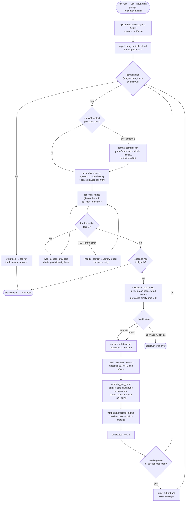

Key invariants: the system prompt is built once per session and never
re-rendered; every durable message is persisted the moment it exists;
ephemeral repair scaffolding is never written to the DB.

## 2. Tool dispatch pipeline

How one batch of tool calls flows from model output to persisted results.
→ [tools.md](tools.md)

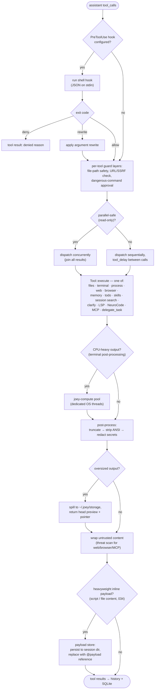

## 3. Provider stack

`joey-providers`: one client, ten registered profiles, three wire
protocols. → [providers.md](providers.md)

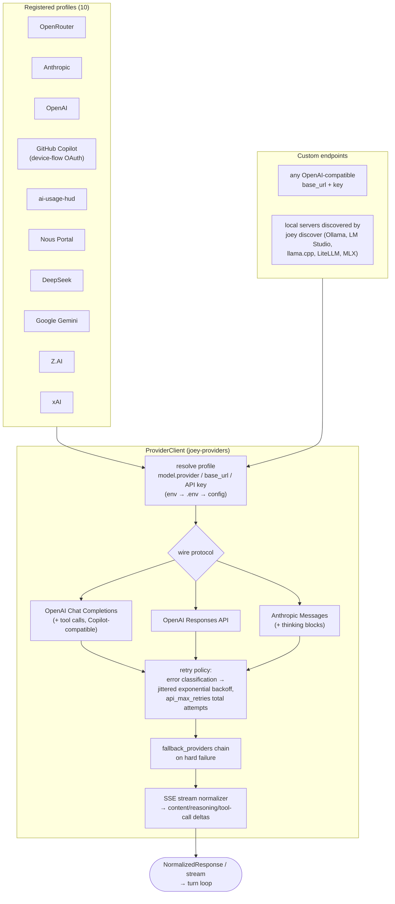

## 4. System prompt assembly

Built exactly once per session (`Agent::new` → `build_system_prompt`) so
provider prompt-prefix caches stay warm. →
[agent-core-reference.md](agent-core-reference.md#2-system-prompt-assembly-promptrs-guidancers)

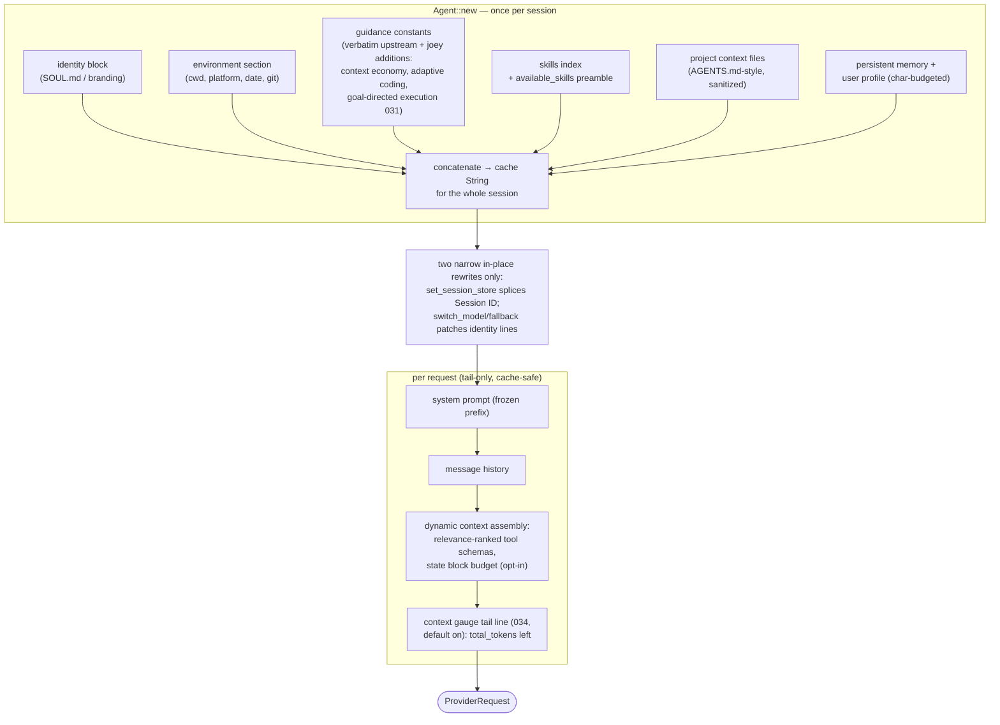

## 5. Context management pipeline

Four cooperating layers keep long sessions inside the model window.
→ [context-economy.md](context-economy.md),
[context-assembly.md](context-assembly.md),
[agent-core-reference.md](agent-core-reference.md#3-context-compression-compression)

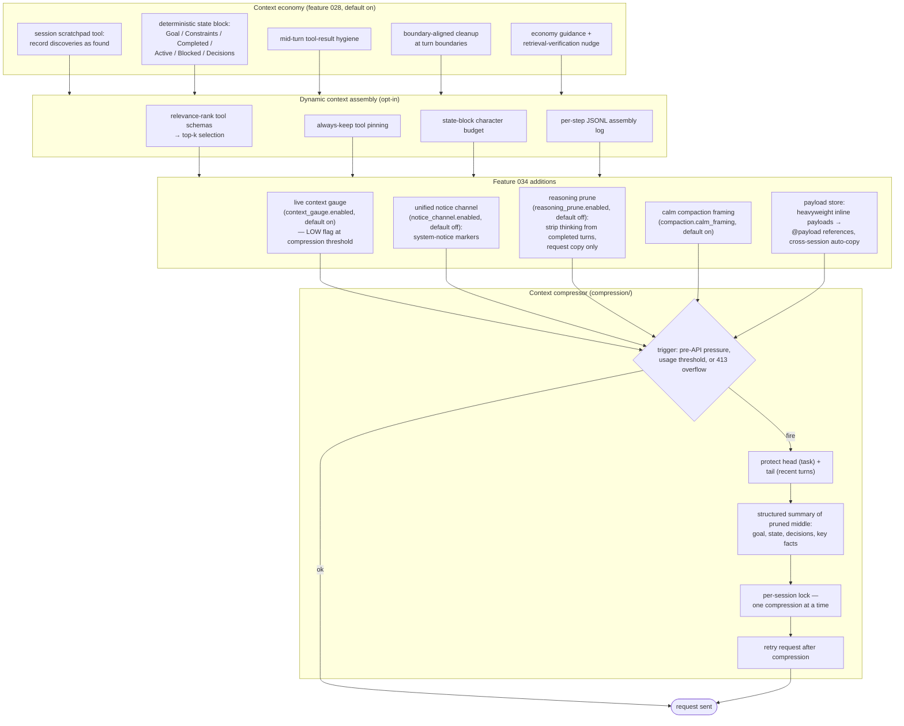

## 6. Subagent delegation (`delegate_task`)

`joey-orchestration::SubagentManager` — isolated child agents under shared
governance. → [orchestration.md](orchestration.md)

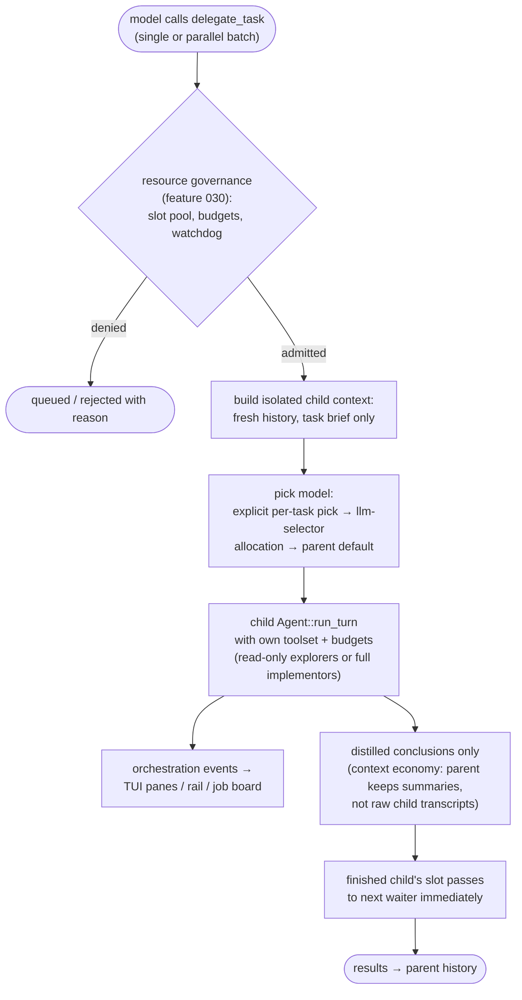

## 7. HyperCode orchestration pipeline

`/hypercode run <goal>` — the orchestrator owns all thinking; children are
execution-only. → [orchestration.md](orchestration.md)

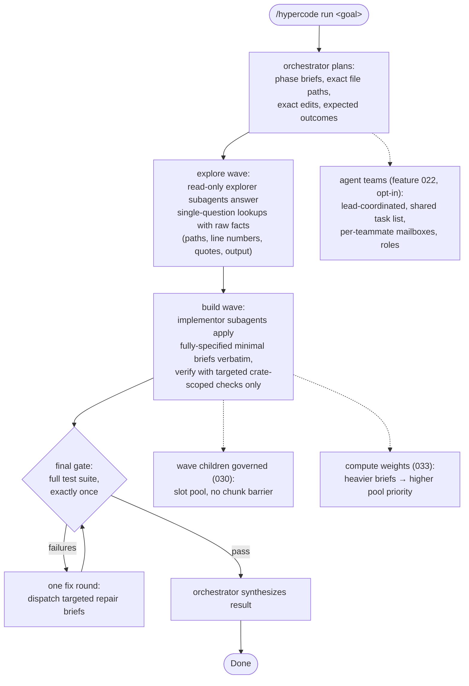

## 8. Browser explorer steering loop (feature 035)

One persistent, orchestrator-steered browser explorer — the orchestrator's
eyes and hands. Opt-out via `hypercode.browser_explorer.enabled` (default
`true`). → [orchestration.md](orchestration.md), [browser.md](browser.md)

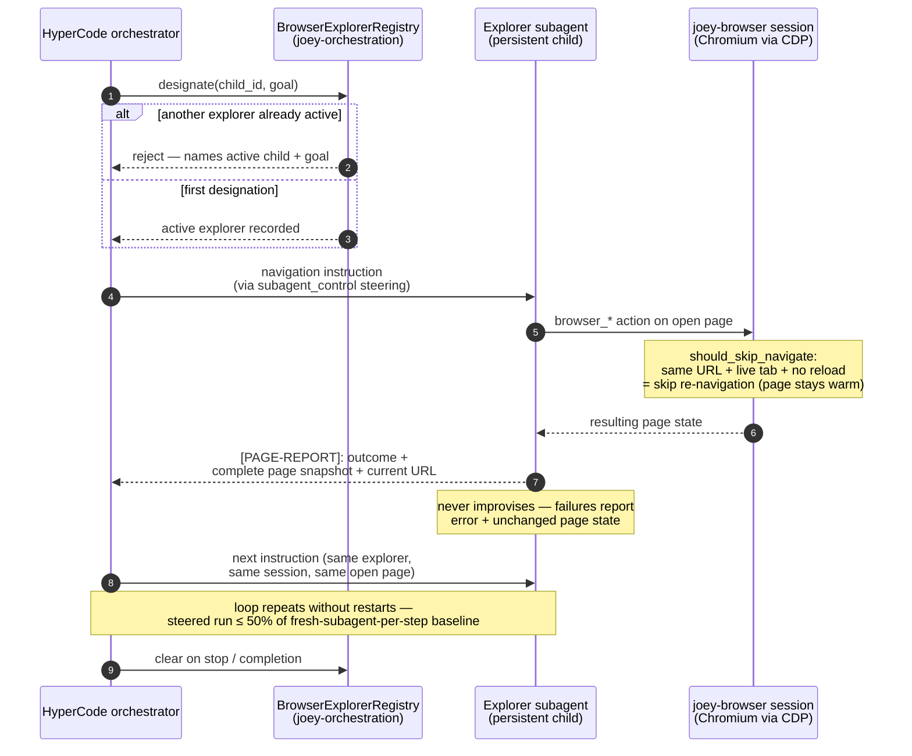

## 9. Enterprise TaskGraph runtime (spec 023)

The typed, evidence-producing execution plane behind
`hypercode.execution_graph.enabled` (default off). →
[architecture.md](architecture.md#enterprise-orchestration-runtime-spec-023)

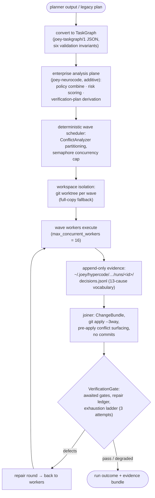

## 10. NeuroCode code intelligence + RAG

Per-project code graph + semantic retrieval. →
[features/joey-neurocode.md](features/joey-neurocode.md),
[features/joey-neurocode-rag.md](features/joey-neurocode-rag.md)

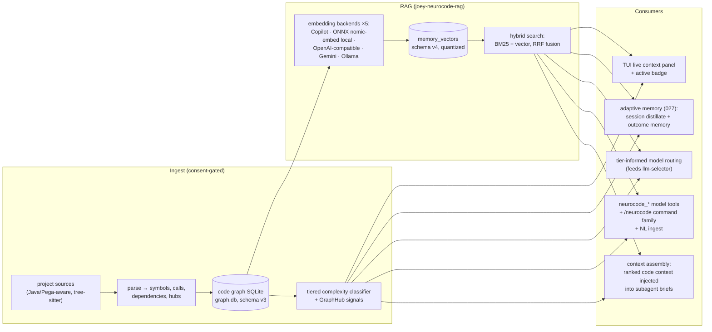

## 11. Compute pool (feature 033)

`joey-compute` — CPU work never touches tokio workers. →
[compute-pool.md](compute-pool.md)

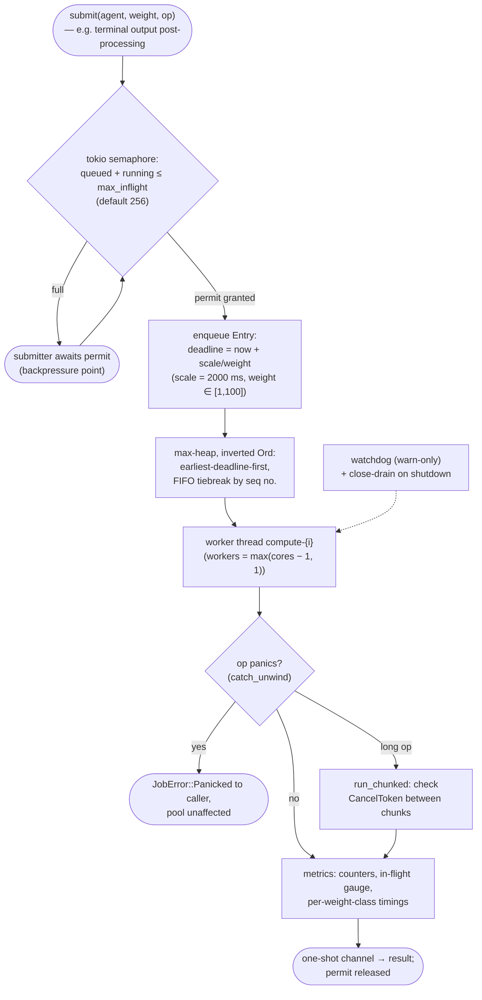

Starvation bound: a weight-1 job waits at most `scale` even under
sustained weight-100 pressure — verified by the fairness suite.

## 12. Dynamic LLM selector

`model.default = auto` engages per-module model allocation. →
[features/joey-llm-selector.md](features/joey-llm-selector.md)

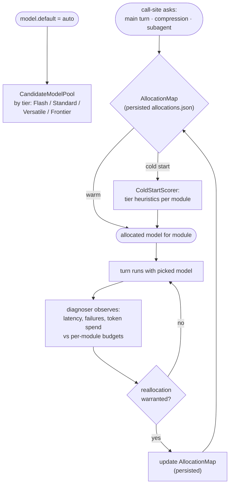

Explicit `--model`/`--provider` pins always win — dynamic routing never
rewrites an explicit pick.

## 13. Security and sanitization layers

Defense in depth: every untrusted path has its own layer. →
[security.md](security.md)

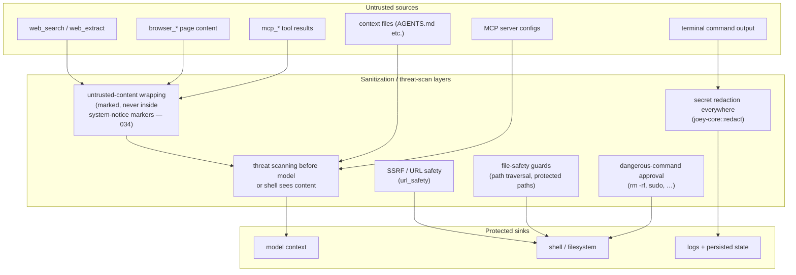

Plus: credentials only in `.env` (auto-routed `_KEY`/`_TOKEN`/`_SECRET`/
`_PASSWORD` keys), sandboxing knobs, safe mode, and the deliberate
omission of Anthropic-OAuth subscription impersonation.

## 14. TUI engine-actor decoupling

The GUI never blocks on compute; a stuck engine can't freeze the UI. →
[tui.md](tui.md#guicompute-decoupling-engine-actor-model)

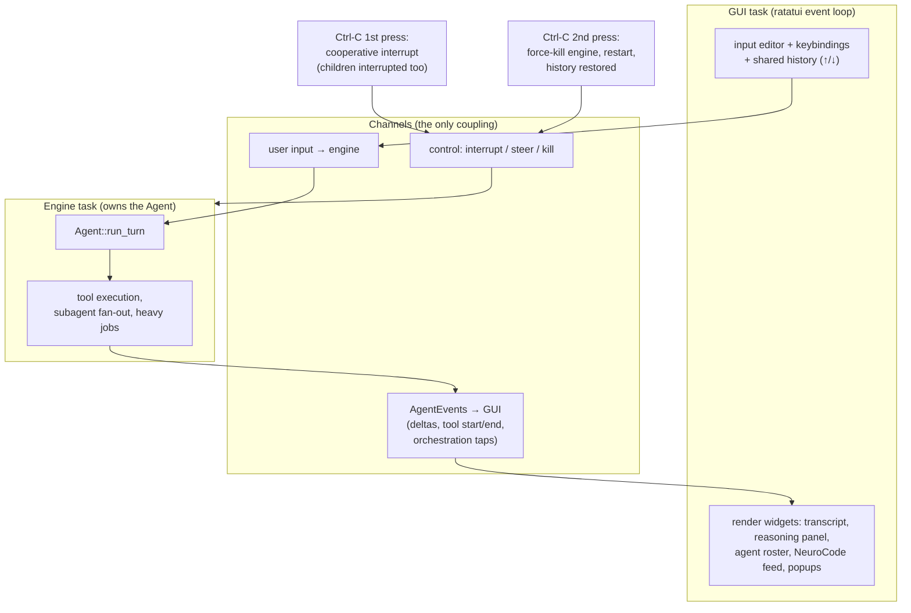

## 15. Cron scheduler lifecycle

Self-contained scheduler, Hermes-compatible `jobs.json`. →
[cron.md](cron.md)

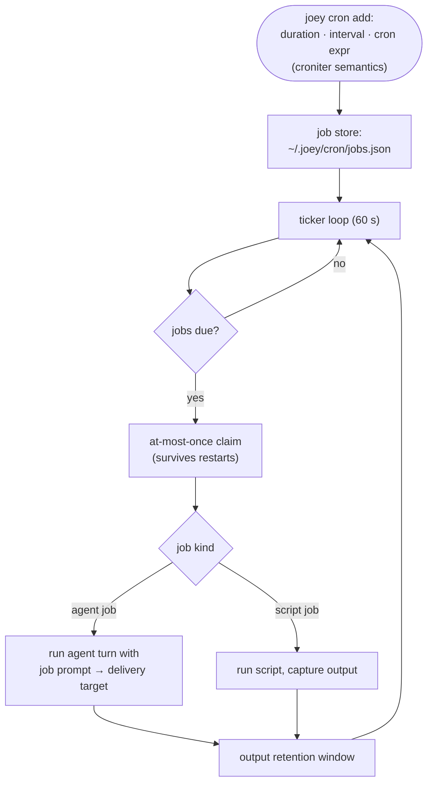

## 16. MCP client lifecycle

`joey-mcp`: stdio JSON-RPC. → [mcp.md](mcp.md)

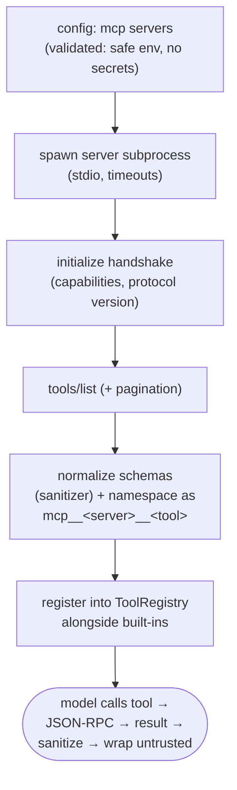

## 17. SpecKit workflow + Visual UI

The spec-kit lifecycle as native commands, plus the browser UI.
→ [speckit-workflow.md](speckit-workflow.md),
[speckit-ui.md](speckit-ui.md)

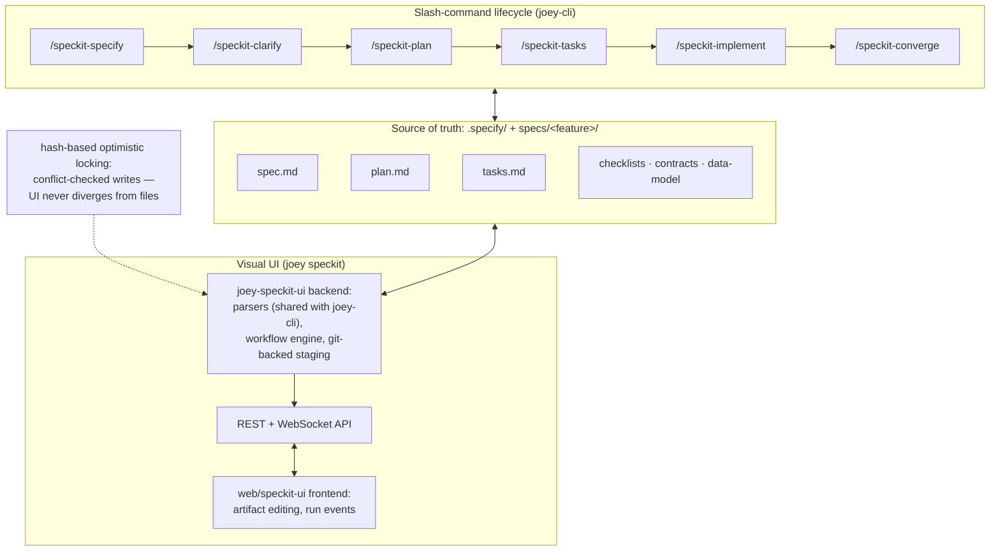

## 18. State and configuration layout

Layered config + one SQLite store per home. →
[state-and-config.md](state-and-config.md)

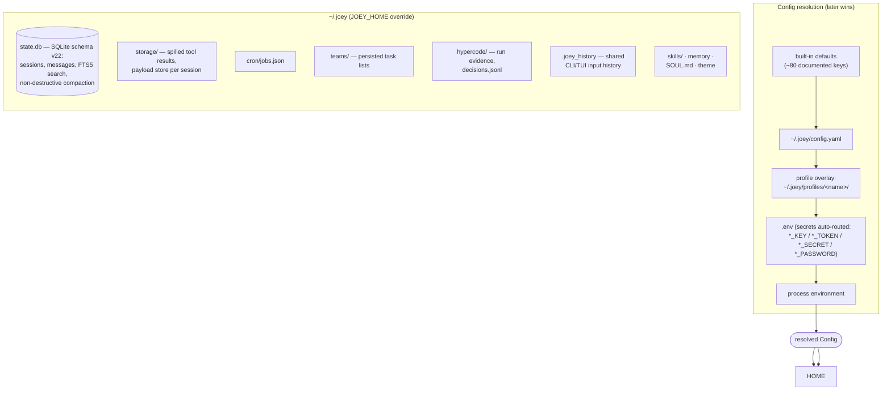

---

## Maintenance note

These diagrams describe behavior, not line numbers — they should stay
accurate as code moves. When a subsystem changes shape (new phase, new
gate, new layer), update the diagram in the same commit. Verified against
workspace source September 2026; if code and diagrams disagree, the code
wins — and please fix the diagram.
